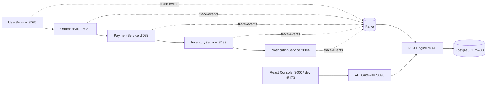

# Graph RCA Microservices

A lightweight, training-free root-cause analysis system for microservice dependencies. The M1 service chain publishes trace events to Kafka; the M2 engine builds a live graph and rolling edge baselines, while the independent React console displays live topology and service telemetry.

## Architecture



Services emit a trace event for every outbound HTTP call. The engine consumes those events, maintains a directed adjacency graph, and calculates a rolling latency/error baseline, EWMA, p95, call rate and z-score per edge. A periodic graph snapshot is persisted to PostgreSQL by the engine. The gateway exposes graph and metric APIs and streams updates over Server-Sent Events. The frontend is a separate application and accesses telemetry only through the gateway.

## Run with Docker Compose

Requirements: Docker Desktop with the Compose plugin.

```powershell
docker compose up --build -d
docker compose ps
```

The first build compiles the Java 17 services and frontend, starts Kafka and PostgreSQL, applies Flyway migrations, and then starts the graph engine, API gateway, and console. Follow startup logs with `docker compose logs -f rca-engine api-gateway frontend`. The database password defaults to a local development value; override it by setting `POSTGRES_PASSWORD` in the shell before starting Compose.

Open the console at **http://localhost:3000**. Its live connection indicator should become green when the API gateway is available. The host development server may also be run independently:

```powershell
cd frontend
npm install
npm run dev
```

Open **http://localhost:5173** for Vite. Its `/api` requests are proxied to `http://localhost:8090`; keep the Compose backend running.

## Generate traffic

Send a single trace through the complete User → Order → Payment → Inventory → Notification chain:

```powershell
Invoke-RestMethod http://localhost:8085/process
```

To keep traffic flowing while watching the Overview or Live Service Graph page, start this PowerShell loop and stop it with Ctrl+C:

```powershell
while ($true) {
  Invoke-RestMethod http://localhost:8085/process | Out-Null
  Start-Sleep -Seconds 1
}
```

Each completed chain adds four Kafka edge events. The graph updates as events are consumed; service metrics show `Awaiting telemetry` until a service has recent trace activity. Click a node to inspect service metrics or an edge to inspect its rolling baseline. M1 fault injection remains available, for example:

```powershell
Invoke-RestMethod -Method Post `
  -Uri http://localhost:8082/fault `
  -ContentType "application/json" `
  -Body '{"type":"LATENCY","magnitude":2000,"durationSec":60}'
```

## Ports

| Component | Host port | Useful URL |
|---|---:|---|
| API Gateway | 8090 | http://localhost:8090 |
| RCA Engine | 8091 | http://localhost:8091/actuator/health |
| UserService | 8085 | http://localhost:8085/actuator/health |
| OrderService | 8081 | http://localhost:8081/actuator/health |
| PaymentService | 8082 | http://localhost:8082/actuator/health |
| InventoryService | 8083 | http://localhost:8083/actuator/health |
| NotificationService | 8084 | http://localhost:8084/actuator/health |
| PostgreSQL | 5433 | `localhost:5433` |
| Frontend (Docker) | 3000 | http://localhost:3000 |
| Frontend (Vite dev) | 5173 | http://localhost:5173 |

No application container is mapped to host port 8080.

## API

All browser requests use the API gateway at `http://localhost:8090`.

| Method | Path | Description |
|---|---|---|
| GET | `/api/graph/current` | Current directed graph, service health, and edge statistics |
| GET | `/api/graph/history?limit=50` | Latest persisted graph snapshots |
| GET | `/api/metrics/edges` | Rolling per-edge baseline and call metrics |
| GET | `/api/services` | Service health and aggregate traffic statistics |
| GET | `/api/stream` | SSE stream with `graph` and `metrics` events, emitted every second |
| GET | `/actuator/health` | API gateway health |

Health checks for the five M1 services are available at `/actuator/health` on each service's host port. Each service also supports `POST /fault` with the M1 fault request contract.

## Frontend routes

- `/` — Overview dashboard with fleet status, traffic, latency snapshots, and recent activity.
- `/graph` — Interactive React Flow service graph with live edge status and a metrics detail panel.
- `/incidents` and `/faults` — M3 roadmap screens.
- `/metrics`, `/evaluation`, and `/settings` — M4 roadmap screens.

## Configuration

Engine settings can be overridden with environment variables, including `RCA_BASELINE_WINDOW_SIZE`, `RCA_BASELINE_EWMA_ALPHA`, `RCA_RATE_WINDOW_SECONDS`, `RCA_UNHEALTHY_ERROR_RATE`, `RCA_UNHEALTHY_Z_SCORE`, and `RCA_SNAPSHOT_INTERVAL_MS`. Defaults and the full property names are in [application.properties](./backend/rca-engine/src/main/resources/application.properties).

## Milestones

- **M1:** five services, Kafka trace publishing, PostgreSQL, and Flyway schema.
- **M2:** graph consumer and builder, rolling edge baselines and metrics, snapshot persistence, API/SSE gateway, and live Overview/Service Graph console.
- **M3:** anomaly and root-cause analysis, incident view, and fault-injection lab.
- **M4:** evaluation harness, expanded metrics pages, polish, and final QA.

## Screenshots

The console is available at http://localhost:3000 after starting Compose.
